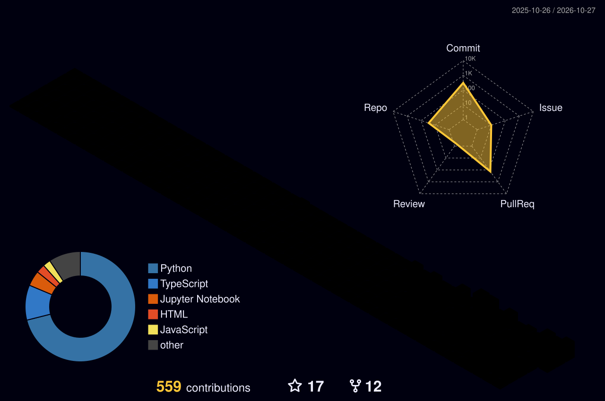

<div align="center">

  <!-- Header Banner -->
  

  <h1>🪐 Celestial &amp; 3D Spatial GitHub Profile Template</h1>
  <p><b>A modern, aesthetic, and interactive GitHub Profile suite with 3D keycaps, telemetry HUD, 3D voxel grass &amp; automated GitHub Actions.</b></p>

  <p>
    <a href="https://github.com/strongsun806/celestial-github-profile/stargazers">
      
    </a>
    <a href="https://github.com/strongsun806/celestial-github-profile/network/members">
      
    </a>
    <a href="https://github.com/strongsun806/celestial-github-profile/blob/main/LICENSE">
      
    </a>
  </p>

  <p>
    <b>⭐ If this template helps level up your profile, please leave a Star to support! ⭐</b>
  </p>

  <p>
    <a href="#-quick-start-60-seconds"><b>🚀 Quick Start</b></a> •
    <a href="#-한국어-사용-가이드-korean-guide"><b>🇰🇷 한국어 가이드</b></a> •
    <a href="#-whats-included"><b>📦 What's Included</b></a> •
    <a href="#-live-components-preview"><b>👀 Live Preview</b></a> •
    <a href="#-automation-workflows"><b>⚙️ Automation Actions</b></a>
  </p>

</div>

<br/>

---

<br/>

## 🇰🇷 한국어 사용 가이드 (Korean Guide)

누구나 **1분 만에** 자신의 깃허브 프로필을 3D 기하학 & 천문학 테마로 꾸밀 수 있는 오픈소스 템플릿입니다!

### 1️⃣ 템플릿으로 내 프로필 레포지토리 만들기
1. 우측 상단의 초록색 **[Use this template]** ➔ **[Create a new repository]** 버튼을 클릭합니다.
2. ⚠️ **가장 중요한 점**: 레포지토리 이름을 **반드시 본인의 GitHub 아이디와 똑같이** 만듭니다!
   - 예: 내 아이디가 `strongsun806`이면 레포지토리 이름도 `strongsun806`

### 2️⃣ 템플릿 복사 & 내 정보로 바꾸기
1. [`template/README.template.md`](./template/README.template.md) 파일을 엽니다.
2. 전체 내용을 복사해서 내 레포지토리 최상위의 `README.md`에 붙여넣습니다.
3. 딱 4개의 플레이스홀더만 내 정보로 수정합니다:
   - `{{YOUR_GITHUB_USERNAME}}` ➔ 내 깃허브 아이디 (예: `strongsun806`)
   - `{{YOUR_NAME}}` ➔ 내 이름 (예: `홍길동`)
   - `{{YOUR_ROLE}}` ➔ 개발 분야/직무 (예: `Frontend Engineer`, `AI Engineer`)
   - `{{YOUR_EMAIL}}` ➔ 연락처 이메일

### 3️⃣ 3D 잔디 & 요약 카드 자동 생성 권한 켜기 (핵심!)
깃허브 액션 봇이 매일 밤 3D 잔디와 카드를 자동으로 그려서 커밋할 수 있도록 권한을 줍니다:
1. 내 레포지토리 상단 메뉴 **[Settings]** ➔ 좌측 사이드바 **[Actions]** ➔ **[General]** 클릭
2. 맨 아래쪽 **Workflow permissions** 섹션에서:
   - 🔘 **Read and write permissions** 선택
   - ☑️ **Allow GitHub Actions to create and approve pull requests** 체크
3. **[Save]** 클릭!
4. 레포지토리 상단의 **[Actions]** 탭으로 가서 `GitHub-Profile-3D-Contrib`을 클릭하고, 우측의 **[Run workflow]** 버튼을 눌러주면 즉시 첫 3D 잔디가 생성됩니다!

<br/>

---

<br/>

## 🚀 Quick Start (English)

You can set up this high-tech profile in **3 simple steps**:

### 1️⃣ Click "Use this template"
Click the green **[Use this template]** button at the top right of this repository, or clone it.
> ⚠️ **Important**: Name your new repository exactly the same as your **GitHub Username** (e.g., `https://github.com/your-username/your-username`).

### 2️⃣ Copy & Fill the Template
1. Open [`template/README.template.md`](./template/README.template.md).
2. Copy its contents into your root `README.md`.
3. Replace the placeholders:
   - `{{YOUR_GITHUB_USERNAME}}` ➔ Your GitHub handle (e.g. `strongsun806`)
   - `{{YOUR_NAME}}` ➔ Your display name
   - `{{YOUR_ROLE}}` ➔ Your job title or tech specialization
   - `{{YOUR_EMAIL}}` ➔ Your contact email

### 3️⃣ Enable GitHub Actions (For 3D Grass & Summary Cards)
1. Go to your repo **Settings** > **Actions** > **General**.
2. Under **Workflow permissions**, select **"Read and write permissions"** and check **"Allow GitHub Actions to create and approve pull requests"**.
3. Go to the **Actions** tab and click **Run workflow** on:
   - `GitHub-Profile-3D-Contrib` (generates the 3D isometric contribution blocks)
   - `GitHub-Profile-Summary-Cards` (generates commit & language cards)
   - `Generate-Contribution-Snake` (generates the animated contribution snake)

🎉 **Done! Your GitHub profile is now transformed into a futuristic 3D observatory!**

<br/>

---

<br/>

## 📦 What's Included

| Component | Description | Preview File |
| :--- | :--- | :--- |
| **🌱 3D Contribution Grass** | Night Rainbow 3D Isometric Voxel Contribution blocks | [`profile-3d-contrib/profile-night-rainbow.svg`](./profile-3d-contrib/profile-night-rainbow.svg) |
| **🪐 Celestial Geometry Emblem** | Rotating orbital rings with 3D octahedron crystal core | [`assets/celestial-geometry.svg`](./assets/celestial-geometry.svg) |
| **🧪 Visual R&D Lab HUD** | Animated 4D Hypercube, GLSL oscilloscope waveforms & radar | [`assets/visual-lab-hud.svg`](./assets/visual-lab-hud.svg) |
| **🎹 3D Tactile Keycaps** | Mechanical keycap styled interactive skillset deck | [`assets/3d-keycaps.svg`](./assets/3d-keycaps.svg) |
| **🧊 3D Milestone Cubes** | Floating isometric cards for featured projects | [`assets/3d-milestone-cubes.svg`](./assets/3d-milestone-cubes.svg) |
| **⚙️ Automated 3D Grass Action** | GitHub Actions workflow generating nightly 3D voxels | [`.github/workflows/profile-3d-contrib.yml`](./.github/workflows/profile-3d-contrib.yml) |
| **📊 Summary Cards Action** | Multi-theme language & commit breakdown cards | [`.github/workflows/profile-summary-cards.yml`](./.github/workflows/profile-summary-cards.yml) |
| **🐍 Snake Grid Action** | Contribution-eating animated cyber snake | [`.github/workflows/snake-contrib.yml`](./.github/workflows/snake-contrib.yml) |

<br/>

---

<br/>

## 👀 Live Components Preview

### 1. 🌱 3D 입체 잔디 (3D Isometric Contribution Grass)
실제 GitHub 잔디 데이터를 기반으로 생성되는 화려한 입체 복셀(Voxel) 블록 그래프입니다!
`profile-3d-contrib/` 폴더 내에 10가지 테마(`profile-night-rainbow`, `profile-night-view`, `profile-green`, `profile-gitblock` 등)가 제공됩니다.

<div align="center">
  
</div>

<br/>

### 2. 🪐 Celestial Geometry Emblem & Visual Lab HUD
CSS 네이티브 애니메이션이 탑재된 순수 벡터 SVG 그래픽입니다. 외부 서버 장애나 링크 깨짐이 없습니다.

<div align="center">
  
  <br/><br/>
  
</div>

<br/>

### 3. 🎹 3D Tactile Skill Deck & Isometric Cubes
다크 모드에 최적화된 톡톡 튀는 3D 기하학 키캡과 플로팅 프로젝트 카드입니다.

<div align="center">
  
  <br/><br/>
  
</div>

<br/>

---

<br/>

## ⚙️ Automation Actions Setup

이 레포지토리에는 깃허브 공식 규격의 워크플로우 3종이 내장되어 있습니다:

```yaml
# 1. 3D 입체 잔디 생성 (매일 1회 자동 실행)
- uses: yoshi389111/github-profile-3d-contrib@latest

# 2. 프로필 요약 카드 생성 (도넛 차트 & 언어 통계)
- uses: vn7n24fzkq/github-profile-summary-cards@release

# 3. 사이버 스네이크 게임 생성 (잔디 먹는 애니메이션)
- uses: Platane/snk/svg-only@v3
```

모든 결과물은 여러분의 레포지토리에 자동 커밋되어 추가 관리 비용 없이 항상 최신 상태를 유지합니다.

<br/>

---

<br/>

## 🎨 Customization Tips

<details>
<summary><b>🌱 3D 잔디 테마 바꾸는 법</b></summary>

`README.md`에서 3D 잔디 이미지 경로를 원하는 테마 파일명으로 변경하세요:
- `./profile-3d-contrib/profile-night-rainbow.svg` (기본 추천: 화려한 네온 무지개)
- `./profile-3d-contrib/profile-night-view.svg` (모던한 다크 뷰)
- `./profile-3d-contrib/profile-green.svg` (클래식 그린 잔디)
- `./profile-3d-contrib/profile-gitblock.svg` (마인크래프트 복셀 블록 스타일)
</details>

<details>
<summary><b>✨ 실시간 타이핑 텍스트 바꾸는 법</b></summary>

`README.md`의 `readme-typing-svg` 링크에서 `lines` 파라미터를 수정하세요:
```markdown
https://readme-typing-svg.demolab.com?color=38BDF8&lines=한글+문구+입력;두번째+줄+문구
```
띄어쓰기는 `+`로 표기하고 세미콜론(`;`)으로 다음 줄을 구분합니다.
</details>

<br/>

---

<br/>

<div align="center">

  <h3>🌟 마음에 드셨다면 Star(⭐)를 눌러주세요!</h3>
  <p>이 템플릿이 유용했다면 레포지토리 우측 상단의 <b>Star (⭐)</b>를 꾹 눌러주세요!<br/>여러분의 스타는 멋진 오픈소스 개발에 큰 힘이 됩니다 💙</p>

  <br/>

  <a href="https://github.com/strongsun806/celestial-github-profile">
    
  </a>

  <br/><br/>

  <sub>Crafted with 💙 &amp; Spatial Web passion by <a href="https://github.com/strongsun806"><b>Hyegang Kwon (@strongsun806)</b></a></sub>

</div>
